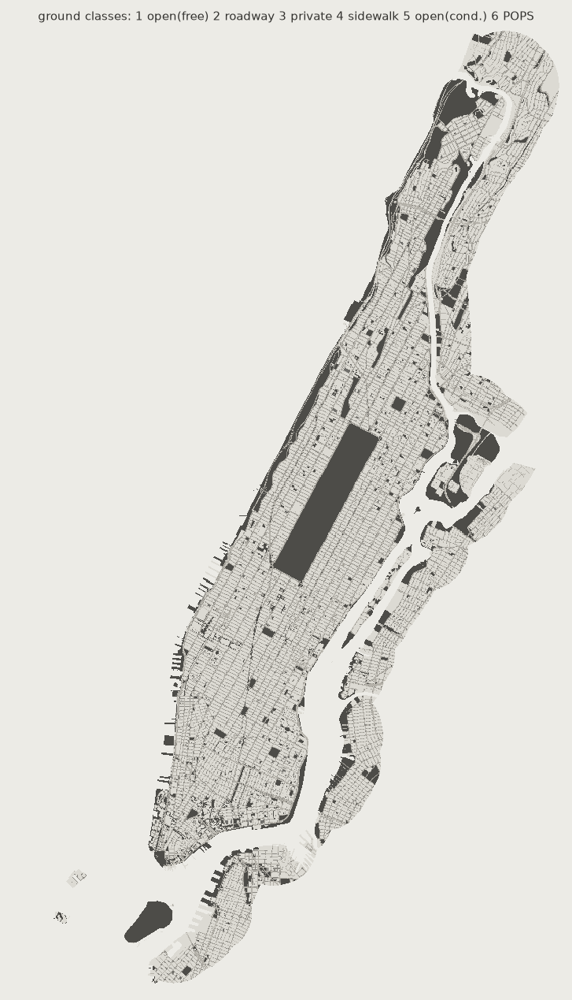
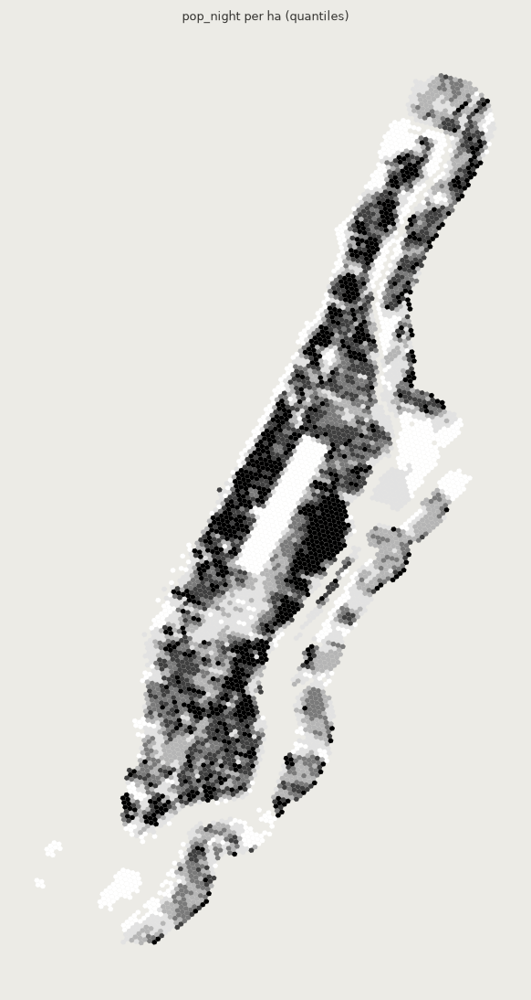
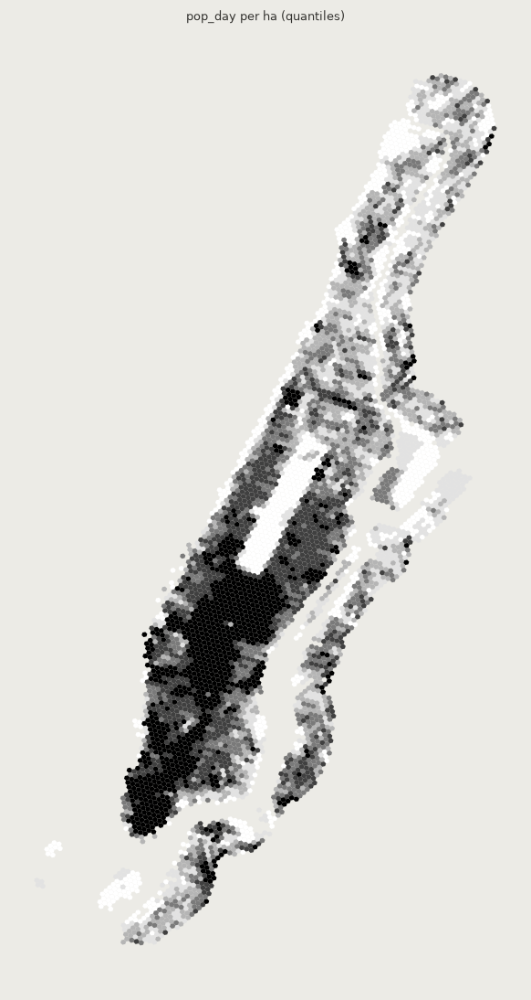
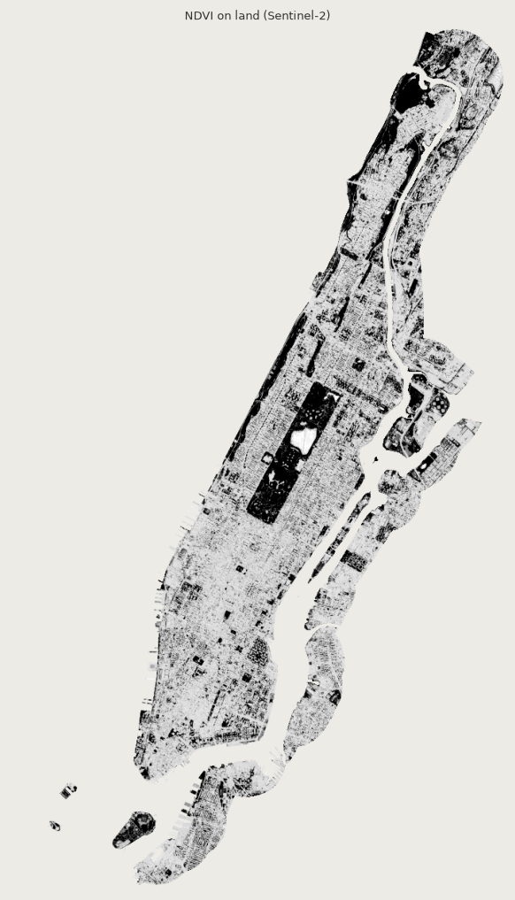

# 데이터 보고서 — 맨해튼 (manhattan)

좌표계 `EPSG:32618` · 생성 `make data REGION=manhattan`

## 레이어 (연구 범위 = 대상 + 버퍼)

| 레이어 | 피처 수 | 면적 합 (km²) | 길이 합 (km) | 합계 |
| --- | ---: | ---: | ---: | --- |
| open_spaces | 1,639 | 20.850 | 0.0 |  |
| temporary_spaces | 163 | 0.000 | 17.1 |  |
| sidewalks | 7,583 | 9.830 | 0.0 |  |
| roadways | 14,823 | 17.894 | 0.0 |  |
| centerlines | 13,858 | 0.000 | 1,313.6 |  |
| buildings | 69,981 | 27.008 | 0.0 |  |
| pop_night | 5,862 | 125.619 | 0.0 | sum_pop=2,174,403 |
| pop_day | 5,862 | 125.619 | 0.0 | sum_jobs=2,699,138 |
| landuse | 64,067 | 0.000 | 0.0 |  |
| income | 467 | 97.848 | 0.0 |  |
| pois | 18,999 | 0.000 | 0.0 |  |
| labels | 467 | 97.848 | 0.0 |  |

## 공간 (정의별)

| 정의 | 공간 수 | 면적 합 (ha) |
| --- | ---: | ---: |
| green_only | 258 | 1,240.4 |
| with_plaza_playground | 1,120 | 2,036.2 |
| with_pops | 1,373 | 2,065.3 |

출입구를 경계에서 찾지 못해 대표점 최근접 노드로 대신한 공간: 96개

## 격자

- H3 셀 5,581개 (대상 안 3,900개)
- 대상 안 야간 인구 합 1,688,873, 일자리 합 2,498,828
- 셀 중심→보행 노드 거리 중앙값 28.7 m, 최대 347.7 m

## 녹지성 (Sentinel-2 장면)

- `S2C_18TWL_20250822_0_L2A`

## 출처 버전

- census_blocks: TIGER/Line 2020 TABBLOCK20
- lodes: LODES8 WAC 2023
- acs_income: ACS 5-year 2024 B19013
- places: PLACES 2025 release, census tract (GIS friendly)

## 다운로드 기록

| 키 | 출처 | 받은 시각 (UTC) |
| --- | --- | --- |
| target | NYC Open Data gthc-hcne (shoreline-clipped) | 2026-10-10T15:31:56+00:00 |
| nyc_boroughs | NYC Open Data gthc-hcne | 2026-10-10T15:31:56+00:00 |
| nyc_parks | NYC Open Data enfh-gkve | 2026-10-10T15:30:36+00:00 |
| nyc_plazas | NYC Open Data k5k6-6jex | 2026-10-10T15:30:36+00:00 |
| nyc_wpaa | NYC Open Data 388s-pnvc | 2026-10-10T15:30:36+00:00 |
| nyc_schoolyards | NYC Open Data bbtf-6p3c | 2026-10-10T15:30:36+00:00 |
| nyc_pops | NYC Open Data rvih-nhyn | 2026-10-10T15:30:36+00:00 |
| nyc_open_streets | NYC Open Data uiay-nctu | 2026-10-10T15:17:44+00:00 |
| nyc_sidewalks | NYC Open Data 52n9-sdep | 2026-10-10T15:18:05+00:00 |
| nyc_roadbed | NYC Open Data i36f-5ih7 | 2026-10-10T15:18:52+00:00 |
| nyc_centerline | NYC Open Data inkn-q76z | 2026-10-10T15:19:00+00:00 |
| nyc_buildings | NYC Open Data 5zhs-2jue | 2026-10-10T15:19:46+00:00 |
| census_blocks | US Census TIGER/Line 2020 TABBLOCK20 (POP20) | 2026-10-10T15:20:00+00:00 |
| lodes_wac | LEHD LODES8 WAC S000 JT00 2023 | 2026-10-10T15:20:02+00:00 |
| nyc_pluto | NYC Open Data 64uk-42ks (PLUTO) | 2026-10-10T15:20:10+00:00 |
| nyc_tracts | NYC Open Data 63ge-mke6 | 2026-10-10T15:22:59+00:00 |
| acs_income | ACS 5-year 2024 B19013 table-based summary file | 2026-10-10T15:20:13+00:00 |
| osm_pois | OpenStreetMap via Overpass (osmnx) | 2026-10-10T15:22:59+00:00 |
| places | PLACES 2025 release, census tract (GIS friendly) | 2026-10-10T15:22:59+00:00 |
| osm_open_spaces | OpenStreetMap via Overpass (osmnx) | 2026-10-10T15:30:36+00:00 |
| walk_network | OpenStreetMap via osmnx graph_from_polygon(network_type='walk') | 2026-10-10T15:26:35+00:00 |
| ndvi | Sentinel-2 L2A via Earth Search STAC (element84) | 2026-10-10T15:30:48+00:00 |

## 레이어 그림

