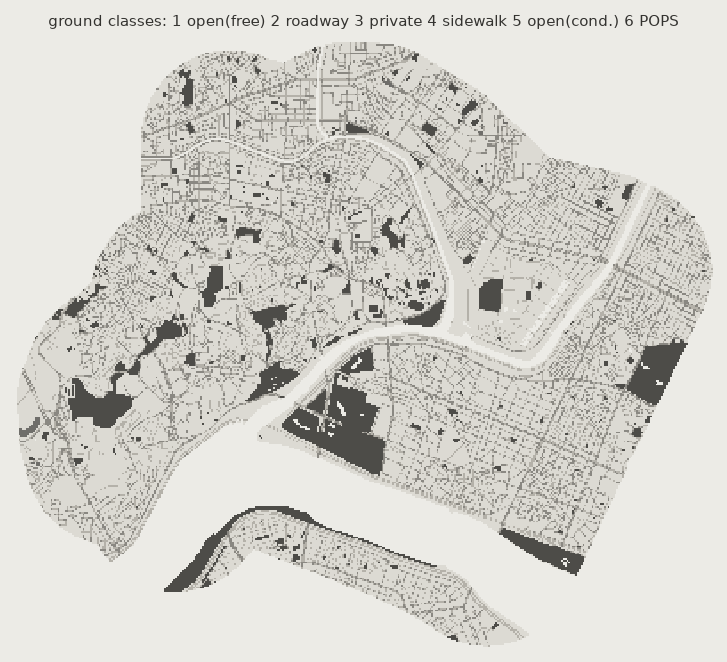
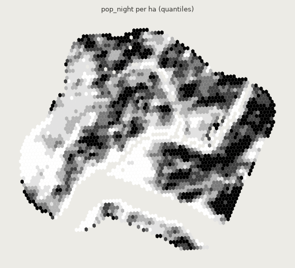
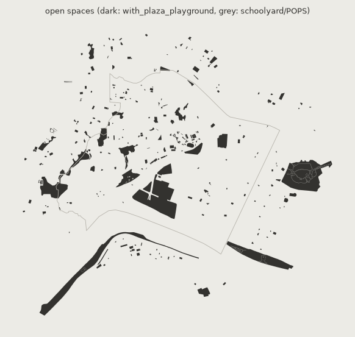
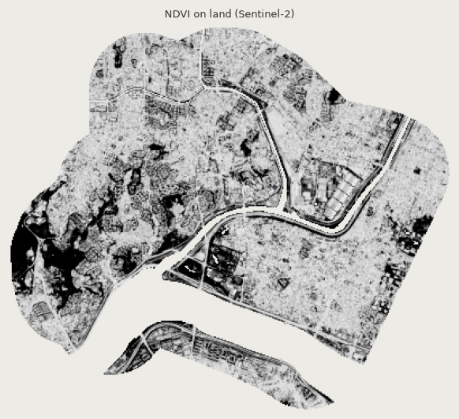

# 데이터 보고서 — 서울 성동구 (seongdong)

좌표계 `EPSG:32652` · 생성 `make data REGION=seongdong`

## 레이어 (연구 범위 = 대상 + 버퍼)

| 레이어 | 피처 수 | 면적 합 (km²) | 길이 합 (km) | 합계 |
| --- | ---: | ---: | ---: | --- |
| open_spaces | 328 | 3.897 | 0.0 |  |
| temporary_spaces | 데이터 없음 | | | |
| sidewalks | 4,770 | 3.527 | 0.0 |  |
| roadways | 6,364 | 6.241 | 0.0 |  |
| centerlines | 4,832 | 0.000 | 687.7 |  |
| buildings | 13,584 | 4.388 | 0.0 |  |
| pop_night | 3,468 | 34.618 | 0.0 | sum_pop=742,537 |
| pop_day | 데이터 없음 | | | |
| landuse | 500 | 0.000 | 0.0 |  |
| income | 데이터 없음 | | | |
| pois | 11,049 | 0.000 | 0.0 |  |
| labels | 데이터 없음 | | | |

## 공간 (정의별)

| 정의 | 공간 수 | 면적 합 (ha) |
| --- | ---: | ---: |
| green_only | 96 | 226.6 |
| with_plaza_playground | 304 | 379.4 |
| with_pops | 304 | 379.4 |

출입구를 경계에서 찾지 못해 대표점 최근접 노드로 대신한 공간: 32개

## 격자

- H3 셀 3,082개 (대상 안 1,376개)
- 대상 안 야간 인구 합 305,037, 일자리 합 0
- 셀 중심→보행 노드 거리 중앙값 27.1 m, 최대 313.9 m

## 녹지성 (Sentinel-2 장면)

- `S2C_52SCG_20250710_0_L2A`

## 출처 버전

## 다운로드 기록

| 키 | 출처 | 받은 시각 (UTC) |
| --- | --- | --- |
| target | OSM Nominatim | 2026-10-11T05:57:51+00:00 |
| osm_water | OpenStreetMap via Overpass (osmnx) | 2026-10-11T05:57:51+00:00 |
| osm_open_spaces | OpenStreetMap via Overpass (osmnx) | 2026-10-10T16:03:35+00:00 |
| osm_streets | OpenStreetMap via Overpass (osmnx) | 2026-10-10T16:03:48+00:00 |
| osm_buildings | OpenStreetMap via Overpass (osmnx) | 2026-10-10T16:04:03+00:00 |
| ghsl_pop | GHSL GHS-POP E2025 R2023A 100 m (JRC) | 2026-10-10T16:04:06+00:00 |
| osm_landuse | OpenStreetMap via Overpass (osmnx) | 2026-10-10T16:04:24+00:00 |
| osm_pois | OpenStreetMap via Overpass (osmnx) | 2026-10-10T16:05:46+00:00 |
| walk_network | OpenStreetMap via osmnx graph_from_polygon(network_type='walk') | 2026-10-10T16:06:01+00:00 |
| ndvi | Sentinel-2 L2A via Earth Search STAC (element84) | 2026-10-10T16:06:05+00:00 |

## 레이어 그림

