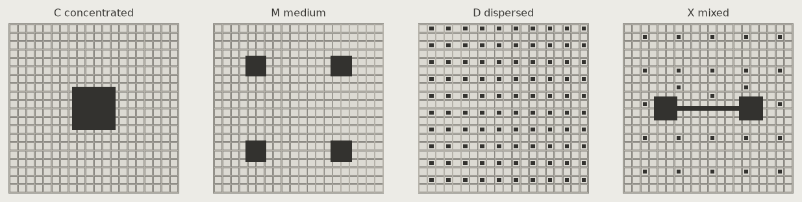

# 시나리오 실험실 결과 (M3)

run `run-001` · params_hash `7e96a1ded779` · 원자료 `reports/scenarios_run-001.csv` (1280행)

추상 격자 도시에서 **총 공공공간 면적을 고정**하고 배치만 바꾼 결과다. 결론을 내리지 않는다 — 어떤 조건에서 어떤 배치의 값이 큰지, 그리고 그것이 **뒤집히는 경계**만 적는다. 가설과 반증 조건은 `HYPOTHESES.md`(실행 전 고정).

## 도시와 배치

- 20×20 블록, 블록 80 m, 가로 20 m(보도 4 m×2), 도시 한 변 2020 m, 보행 노드 간격 50 m
- 주거 밀도 250 인/ha(블록 면적), 총 공공공간 = 블록 면적 합의 10%

| 배치 | 공간 수 | 총 면적 (ha) | 인구(기회비용 없음) | nolli | 경계 밀도 (m/ha) | 혼재도 5/10/20/40 m | 최대 패치 (ha) | 핵심 면적 (ha) |
| --- | ---: | ---: | ---: | ---: | ---: | --- | ---: | ---: |
| C concentrated | 1 | 25.60 | 64,000 | 0.230 | 297.6 | 0.24 / 0.26 / 0.69 / 0.09 | 26.01 | 21.71 |
| M medium | 4 | 25.60 | 64,000 | 0.226 | 298.8 | 0.24 / 0.27 / 0.69 / 0.26 | 6.25 | 18.14 |
| D dispersed | 100 | 25.60 | 64,000 | 0.238 | 362.7 | 0.29 / 0.36 / 0.82 / 1.02 | 0.25 | 1.12 |
| X mixed | 28 | 25.60 | 64,000 | 0.230 | 316.1 | 0.25 / 0.29 / 0.72 / 0.49 | 19.33 | 12.52 |

결 지표(nolli·경계 밀도·혼재도·최대 패치·핵심 면적)는 α·β와 무관하다. 보도가 모든 배치에서 같으므로 nolli 차이는 작다.

## 접근성 — 어느 배치의 값이 가장 큰가

칸 = 가장 큰 배치(C 집중 · M 중간 · D 분산 · X 혼합) · D/C 비율. 비율 > 1이면 분산형이 집중형보다 큼.

### 접근성 평균 (혼잡 없음 = os_gravity, 혼잡 = os_g2sfca, 인구 가중)

**감쇠 gaussian · 혼잡 없음 · 기회비용 없음 · 공원 장벽 없음**

| α \ β | 0 | 0.25 | 0.5 | 0.75 | 1 |
| --- | :---: | :---: | :---: | :---: | :---: |
| 0.3 | D · 10.24 | D · 3.27 | X · 1.84 | M · 1.20 | M · 0.82 |
| 0.5 | D · 4.08 | D · 1.30 | X · 0.73 | M · 0.48 | M · 0.32 |
| 0.7 | D · 1.62 | C · 0.52 | M · 0.29 | M · 0.19 | M · 0.13 |
| 1 | C · 0.41 | C · 0.13 | C · 0.07 | C · 0.05 | C · 0.03 |

**감쇠 gaussian · 혼잡 없음 · 기회비용 없음 · 공원 장벽 있음**

| α \ β | 0 | 0.25 | 0.5 | 0.75 | 1 |
| --- | :---: | :---: | :---: | :---: | :---: |
| 0.3 | D · 33.29 | D · 4.92 | X · 2.06 | M · 1.34 | M · 0.92 |
| 0.5 | D · 13.25 | D · 1.96 | M · 0.82 | M · 0.54 | M · 0.36 |
| 0.7 | D · 5.28 | X · 0.78 | M · 0.33 | M · 0.21 | M · 0.15 |
| 1 | M · 1.33 | C · 0.20 | C · 0.08 | M · 0.05 | M · 0.04 |

**감쇠 gaussian · 혼잡 없음 · 기회비용 있음 · 공원 장벽 없음**

| α \ β | 0 | 0.25 | 0.5 | 0.75 | 1 |
| --- | :---: | :---: | :---: | :---: | :---: |
| 0.3 | D · 10.24 | D · 3.27 | X · 1.84 | M · 1.20 | M · 0.82 |
| 0.5 | D · 4.08 | D · 1.30 | X · 0.73 | M · 0.48 | M · 0.32 |
| 0.7 | D · 1.62 | C · 0.52 | M · 0.29 | M · 0.19 | M · 0.13 |
| 1 | C · 0.41 | C · 0.13 | C · 0.07 | C · 0.05 | C · 0.03 |

**감쇠 gaussian · 혼잡 없음 · 기회비용 있음 · 공원 장벽 있음**

| α \ β | 0 | 0.25 | 0.5 | 0.75 | 1 |
| --- | :---: | :---: | :---: | :---: | :---: |
| 0.3 | D · 33.29 | D · 4.92 | X · 2.06 | M · 1.34 | M · 0.92 |
| 0.5 | D · 13.25 | D · 1.96 | M · 0.82 | M · 0.54 | M · 0.36 |
| 0.7 | D · 5.28 | X · 0.78 | M · 0.33 | M · 0.21 | M · 0.15 |
| 1 | M · 1.33 | C · 0.20 | C · 0.08 | M · 0.05 | M · 0.04 |

**감쇠 step · 혼잡 없음 · 기회비용 없음 · 공원 장벽 없음**

| α \ β | 0 | 0.25 | 0.5 | 0.75 | 1 |
| --- | :---: | :---: | :---: | :---: | :---: |
| 0.3 | D · 9.70 | D · 4.11 | X · 2.09 | M · 1.28 | M · 0.87 |
| 0.5 | D · 3.86 | D · 1.64 | X · 0.83 | M · 0.51 | M · 0.35 |
| 0.7 | D · 1.54 | C · 0.65 | M · 0.33 | M · 0.20 | M · 0.14 |
| 1 | C · 0.39 | C · 0.16 | C · 0.08 | C · 0.05 | C · 0.03 |

**감쇠 step · 혼잡 없음 · 기회비용 없음 · 공원 장벽 있음**

| α \ β | 0 | 0.25 | 0.5 | 0.75 | 1 |
| --- | :---: | :---: | :---: | :---: | :---: |
| 0.3 | D · 30.84 | D · 5.59 | X · 2.23 | M · 1.37 | M · 0.93 |
| 0.5 | D · 12.28 | D · 2.23 | M · 0.89 | M · 0.55 | M · 0.37 |
| 0.7 | D · 4.89 | X · 0.89 | M · 0.35 | M · 0.22 | M · 0.15 |
| 1 | X · 1.23 | C · 0.22 | C · 0.09 | C · 0.05 | C · 0.04 |

**감쇠 step · 혼잡 없음 · 기회비용 있음 · 공원 장벽 없음**

| α \ β | 0 | 0.25 | 0.5 | 0.75 | 1 |
| --- | :---: | :---: | :---: | :---: | :---: |
| 0.3 | D · 9.70 | D · 4.11 | X · 2.09 | M · 1.28 | M · 0.87 |
| 0.5 | D · 3.86 | D · 1.64 | X · 0.83 | M · 0.51 | M · 0.35 |
| 0.7 | D · 1.54 | C · 0.65 | M · 0.33 | M · 0.20 | M · 0.14 |
| 1 | C · 0.39 | C · 0.16 | C · 0.08 | C · 0.05 | C · 0.03 |

**감쇠 step · 혼잡 없음 · 기회비용 있음 · 공원 장벽 있음**

| α \ β | 0 | 0.25 | 0.5 | 0.75 | 1 |
| --- | :---: | :---: | :---: | :---: | :---: |
| 0.3 | D · 30.84 | D · 5.59 | X · 2.23 | M · 1.37 | M · 0.93 |
| 0.5 | D · 12.28 | D · 2.23 | M · 0.89 | M · 0.55 | M · 0.37 |
| 0.7 | D · 4.89 | X · 0.89 | M · 0.35 | M · 0.22 | M · 0.15 |
| 1 | X · 1.23 | C · 0.22 | C · 0.09 | C · 0.05 | C · 0.04 |

**감쇠 gaussian · 혼잡 있음 (2SFCA) · 기회비용 없음 · 공원 장벽 없음**

| α \ β | 0 | 0.25 | 0.5 | 0.75 | 1 |
| --- | :---: | :---: | :---: | :---: | :---: |
| 0.3 | CDMX · 1.00 | CDMX · 1.00 | CDMX · 1.00 | CDMX · 1.00 | CDMX · 1.00 |
| 0.5 | CDMX · 1.00 | CDMX · 1.00 | CDMX · 1.00 | CDMX · 1.00 | CDMX · 1.00 |
| 0.7 | CDMX · 1.00 | CDMX · 1.00 | CDMX · 1.00 | CDMX · 1.00 | CDMX · 1.00 |
| 1 | CDMX · 1.00 | CDMX · 1.00 | CDMX · 1.00 | CDMX · 1.00 | CDMX · 1.00 |

**감쇠 gaussian · 혼잡 있음 (2SFCA) · 기회비용 없음 · 공원 장벽 있음**

| α \ β | 0 | 0.25 | 0.5 | 0.75 | 1 |
| --- | :---: | :---: | :---: | :---: | :---: |
| 0.3 | CDMX · 1.00 | CDMX · 1.00 | CDMX · 1.00 | CDMX · 1.00 | CDMX · 1.00 |
| 0.5 | CDMX · 1.00 | CDMX · 1.00 | CDMX · 1.00 | CDMX · 1.00 | CDMX · 1.00 |
| 0.7 | CDMX · 1.00 | CDMX · 1.00 | CDMX · 1.00 | CDMX · 1.00 | CDMX · 1.00 |
| 1 | CDMX · 1.00 | CDMX · 1.00 | CDMX · 1.00 | CDMX · 1.00 | CDMX · 1.00 |

**감쇠 gaussian · 혼잡 있음 (2SFCA) · 기회비용 있음 · 공원 장벽 없음**

| α \ β | 0 | 0.25 | 0.5 | 0.75 | 1 |
| --- | :---: | :---: | :---: | :---: | :---: |
| 0.3 | D · 1.04 | D · 1.04 | D · 1.04 | D · 1.04 | D · 1.04 |
| 0.5 | D · 1.04 | D · 1.04 | D · 1.04 | D · 1.04 | D · 1.04 |
| 0.7 | D · 1.04 | D · 1.04 | D · 1.04 | D · 1.04 | D · 1.04 |
| 1 | D · 1.04 | D · 1.04 | D · 1.04 | D · 1.04 | D · 1.04 |

**감쇠 gaussian · 혼잡 있음 (2SFCA) · 기회비용 있음 · 공원 장벽 있음**

| α \ β | 0 | 0.25 | 0.5 | 0.75 | 1 |
| --- | :---: | :---: | :---: | :---: | :---: |
| 0.3 | D · 1.04 | D · 1.04 | D · 1.04 | D · 1.04 | D · 1.04 |
| 0.5 | D · 1.04 | D · 1.04 | D · 1.04 | D · 1.04 | D · 1.04 |
| 0.7 | D · 1.04 | D · 1.04 | D · 1.04 | D · 1.04 | D · 1.04 |
| 1 | D · 1.04 | D · 1.04 | D · 1.04 | D · 1.04 | D · 1.04 |

**감쇠 step · 혼잡 있음 (2SFCA) · 기회비용 없음 · 공원 장벽 없음**

| α \ β | 0 | 0.25 | 0.5 | 0.75 | 1 |
| --- | :---: | :---: | :---: | :---: | :---: |
| 0.3 | CDMX · 1.00 | CDMX · 1.00 | CDMX · 1.00 | CDMX · 1.00 | CDMX · 1.00 |
| 0.5 | CDMX · 1.00 | CDMX · 1.00 | CDMX · 1.00 | CDMX · 1.00 | CDMX · 1.00 |
| 0.7 | CDMX · 1.00 | CDMX · 1.00 | CDMX · 1.00 | CDMX · 1.00 | CDMX · 1.00 |
| 1 | CDMX · 1.00 | CDMX · 1.00 | CDMX · 1.00 | CDMX · 1.00 | CDMX · 1.00 |

**감쇠 step · 혼잡 있음 (2SFCA) · 기회비용 없음 · 공원 장벽 있음**

| α \ β | 0 | 0.25 | 0.5 | 0.75 | 1 |
| --- | :---: | :---: | :---: | :---: | :---: |
| 0.3 | CDMX · 1.00 | CDMX · 1.00 | CDMX · 1.00 | CDMX · 1.00 | CDMX · 1.00 |
| 0.5 | CDMX · 1.00 | CDMX · 1.00 | CDMX · 1.00 | CDMX · 1.00 | CDMX · 1.00 |
| 0.7 | CDMX · 1.00 | CDMX · 1.00 | CDMX · 1.00 | CDMX · 1.00 | CDMX · 1.00 |
| 1 | CDMX · 1.00 | CDMX · 1.00 | CDMX · 1.00 | CDMX · 1.00 | CDMX · 1.00 |

**감쇠 step · 혼잡 있음 (2SFCA) · 기회비용 있음 · 공원 장벽 없음**

| α \ β | 0 | 0.25 | 0.5 | 0.75 | 1 |
| --- | :---: | :---: | :---: | :---: | :---: |
| 0.3 | D · 1.04 | D · 1.04 | D · 1.04 | D · 1.04 | D · 1.04 |
| 0.5 | D · 1.04 | D · 1.04 | D · 1.04 | D · 1.04 | D · 1.04 |
| 0.7 | D · 1.04 | D · 1.04 | D · 1.04 | D · 1.04 | D · 1.04 |
| 1 | D · 1.04 | D · 1.04 | D · 1.04 | D · 1.04 | D · 1.04 |

**감쇠 step · 혼잡 있음 (2SFCA) · 기회비용 있음 · 공원 장벽 있음**

| α \ β | 0 | 0.25 | 0.5 | 0.75 | 1 |
| --- | :---: | :---: | :---: | :---: | :---: |
| 0.3 | D · 1.04 | D · 1.04 | D · 1.04 | D · 1.04 | D · 1.04 |
| 0.5 | D · 1.04 | D · 1.04 | D · 1.04 | D · 1.04 | D · 1.04 |
| 0.7 | D · 1.04 | D · 1.04 | D · 1.04 | D · 1.04 | D · 1.04 |
| 1 | D · 1.04 | D · 1.04 | D · 1.04 | D · 1.04 | D · 1.04 |

#### 뒤집히는 경계 (접근성 평균 (혼잡 없음 = os_gravity, 혼잡 = os_g2sfca, 인구 가중)) — β를 키울 때 D/C가 1을 가로지르는 곳

| 감쇠 | 혼잡 | 기회비용 | 장벽 | α | β 구간 | D/C |
| --- | --- | --- | --- | ---: | --- | --- |
| gaussian | False | False | False | 0.3 | 0.75 → 1 | 1.20 → 0.82 |
| gaussian | False | False | False | 0.5 | 0.25 → 0.5 | 1.30 → 0.73 |
| gaussian | False | False | False | 0.7 | 0 → 0.25 | 1.62 → 0.52 |
| gaussian | False | False | True | 0.3 | 0.75 → 1 | 1.34 → 0.92 |
| gaussian | False | False | True | 0.5 | 0.25 → 0.5 | 1.96 → 0.82 |
| gaussian | False | False | True | 0.7 | 0 → 0.25 | 5.28 → 0.78 |
| gaussian | False | False | True | 1 | 0 → 0.25 | 1.33 → 0.20 |
| gaussian | False | True | False | 0.3 | 0.75 → 1 | 1.20 → 0.82 |
| gaussian | False | True | False | 0.5 | 0.25 → 0.5 | 1.30 → 0.73 |
| gaussian | False | True | False | 0.7 | 0 → 0.25 | 1.62 → 0.52 |
| gaussian | False | True | True | 0.3 | 0.75 → 1 | 1.34 → 0.92 |
| gaussian | False | True | True | 0.5 | 0.25 → 0.5 | 1.96 → 0.82 |
| gaussian | False | True | True | 0.7 | 0 → 0.25 | 5.28 → 0.78 |
| gaussian | False | True | True | 1 | 0 → 0.25 | 1.33 → 0.20 |
| gaussian | True | False | False | 0.3 | 0 → 0.25 | 1.00 → 1.00 |
| gaussian | True | False | False | 0.3 | 0.25 → 0.5 | 1.00 → 1.00 |
| gaussian | True | False | False | 0.5 | 0 → 0.25 | 1.00 → 1.00 |
| gaussian | True | False | False | 0.5 | 0.25 → 0.5 | 1.00 → 1.00 |
| gaussian | True | False | False | 0.7 | 0 → 0.25 | 1.00 → 1.00 |
| gaussian | True | False | False | 0.7 | 0.25 → 0.5 | 1.00 → 1.00 |
| gaussian | True | False | False | 1 | 0 → 0.25 | 1.00 → 1.00 |
| gaussian | True | False | False | 1 | 0.25 → 0.5 | 1.00 → 1.00 |
| step | False | False | False | 0.3 | 0.75 → 1 | 1.28 → 0.87 |
| step | False | False | False | 0.5 | 0.25 → 0.5 | 1.64 → 0.83 |
| step | False | False | False | 0.7 | 0 → 0.25 | 1.54 → 0.65 |
| step | False | False | True | 0.3 | 0.75 → 1 | 1.37 → 0.93 |
| step | False | False | True | 0.5 | 0.25 → 0.5 | 2.23 → 0.89 |
| step | False | False | True | 0.7 | 0 → 0.25 | 4.89 → 0.89 |
| step | False | False | True | 1 | 0 → 0.25 | 1.23 → 0.22 |
| step | False | True | False | 0.3 | 0.75 → 1 | 1.28 → 0.87 |
| step | False | True | False | 0.5 | 0.25 → 0.5 | 1.64 → 0.83 |
| step | False | True | False | 0.7 | 0 → 0.25 | 1.54 → 0.65 |
| step | False | True | True | 0.3 | 0.75 → 1 | 1.37 → 0.93 |
| step | False | True | True | 0.5 | 0.25 → 0.5 | 2.23 → 0.89 |
| step | False | True | True | 0.7 | 0 → 0.25 | 4.89 → 0.89 |
| step | False | True | True | 1 | 0 → 0.25 | 1.23 → 0.22 |

### 공정성: 접근성 하위 10% 값

**감쇠 gaussian · 혼잡 없음 · 기회비용 없음 · 공원 장벽 없음**

| α \ β | 0 | 0.25 | 0.5 | 0.75 | 1 |
| --- | :---: | :---: | :---: | :---: | :---: |
| 0.3 | D · inf | D · 3.01 | X · 1.23 | M · 0.80 | M · 0.54 |
| 0.5 | D · inf | D · 1.20 | M · 0.49 | M · 0.32 | M · 0.22 |
| 0.7 | D · inf | C · 0.48 | C · 0.20 | M · 0.13 | M · 0.09 |
| 1 | M · inf | C · 0.12 | C · 0.05 | C · 0.03 | C · 0.02 |

**감쇠 gaussian · 혼잡 없음 · 기회비용 없음 · 공원 장벽 있음**

| α \ β | 0 | 0.25 | 0.5 | 0.75 | 1 |
| --- | :---: | :---: | :---: | :---: | :---: |
| 0.3 | D · inf | D · 13.34 | X · 1.54 | M · 1.00 | M · 0.68 |
| 0.5 | D · inf | D · 5.31 | M · 0.61 | M · 0.40 | M · 0.27 |
| 0.7 | D · inf | M · 2.11 | M · 0.24 | M · 0.16 | M · 0.11 |
| 1 | M · inf | M · 0.53 | C · 0.06 | M · 0.04 | M · 0.03 |

**감쇠 gaussian · 혼잡 없음 · 기회비용 있음 · 공원 장벽 없음**

| α \ β | 0 | 0.25 | 0.5 | 0.75 | 1 |
| --- | :---: | :---: | :---: | :---: | :---: |
| 0.3 | D · inf | D · 3.01 | X · 1.23 | M · 0.80 | M · 0.54 |
| 0.5 | D · inf | D · 1.20 | M · 0.49 | M · 0.32 | M · 0.22 |
| 0.7 | D · inf | C · 0.48 | C · 0.20 | M · 0.13 | M · 0.09 |
| 1 | M · inf | C · 0.12 | C · 0.05 | C · 0.03 | C · 0.02 |

**감쇠 gaussian · 혼잡 없음 · 기회비용 있음 · 공원 장벽 있음**

| α \ β | 0 | 0.25 | 0.5 | 0.75 | 1 |
| --- | :---: | :---: | :---: | :---: | :---: |
| 0.3 | D · inf | D · 13.34 | X · 1.54 | M · 1.00 | M · 0.68 |
| 0.5 | D · inf | D · 5.31 | M · 0.61 | M · 0.40 | M · 0.27 |
| 0.7 | D · inf | M · 2.11 | M · 0.24 | M · 0.16 | M · 0.11 |
| 1 | M · inf | M · 0.53 | C · 0.06 | M · 0.04 | M · 0.03 |

**감쇠 step · 혼잡 없음 · 기회비용 없음 · 공원 장벽 없음**

| α \ β | 0 | 0.25 | 0.5 | 0.75 | 1 |
| --- | :---: | :---: | :---: | :---: | :---: |
| 0.3 | D · inf | D · 4.52 | X · 1.38 | M · 0.88 | M · 0.50 |
| 0.5 | D · inf | D · 1.80 | X · 0.55 | M · 0.35 | M · 0.20 |
| 0.7 | D · inf | C · 0.72 | C · 0.22 | M · 0.14 | M · 0.08 |
| 1 | M · inf | C · 0.18 | C · 0.05 | C · 0.03 | C · 0.02 |

**감쇠 step · 혼잡 없음 · 기회비용 없음 · 공원 장벽 있음**

| α \ β | 0 | 0.25 | 0.5 | 0.75 | 1 |
| --- | :---: | :---: | :---: | :---: | :---: |
| 0.3 | D · inf | D · 4.52 | X · 2.76 | M · 1.76 | M · 1.00 |
| 0.5 | D · inf | D · 1.80 | X · 1.10 | M · 0.70 | M · 0.40 |
| 0.7 | D · inf | C · 0.72 | X · 0.44 | M · 0.28 | M · 0.16 |
| 1 | M · inf | C · 0.18 | X · 0.11 | M · 0.07 | M · 0.04 |

**감쇠 step · 혼잡 없음 · 기회비용 있음 · 공원 장벽 없음**

| α \ β | 0 | 0.25 | 0.5 | 0.75 | 1 |
| --- | :---: | :---: | :---: | :---: | :---: |
| 0.3 | D · inf | D · 4.52 | X · 1.38 | M · 0.88 | M · 0.50 |
| 0.5 | D · inf | D · 1.80 | X · 0.55 | M · 0.35 | M · 0.20 |
| 0.7 | D · inf | C · 0.72 | C · 0.22 | M · 0.14 | M · 0.08 |
| 1 | M · inf | C · 0.18 | C · 0.05 | C · 0.03 | C · 0.02 |

**감쇠 step · 혼잡 없음 · 기회비용 있음 · 공원 장벽 있음**

| α \ β | 0 | 0.25 | 0.5 | 0.75 | 1 |
| --- | :---: | :---: | :---: | :---: | :---: |
| 0.3 | D · inf | D · 4.52 | X · 2.76 | M · 1.76 | M · 1.00 |
| 0.5 | D · inf | D · 1.80 | X · 1.10 | M · 0.70 | M · 0.40 |
| 0.7 | D · inf | C · 0.72 | X · 0.44 | M · 0.28 | M · 0.16 |
| 1 | M · inf | C · 0.18 | X · 0.11 | M · 0.07 | M · 0.04 |

**감쇠 gaussian · 혼잡 있음 (2SFCA) · 기회비용 없음 · 공원 장벽 없음**

| α \ β | 0 | 0.25 | 0.5 | 0.75 | 1 |
| --- | :---: | :---: | :---: | :---: | :---: |
| 0.3 | D · inf | D · 1.02 | C · 0.78 | C · 0.76 | C · 0.71 |
| 0.5 | D · inf | D · 1.02 | C · 0.78 | C · 0.76 | C · 0.71 |
| 0.7 | D · inf | D · 1.02 | C · 0.78 | C · 0.76 | C · 0.71 |
| 1 | D · inf | D · 1.02 | C · 0.78 | C · 0.76 | C · 0.71 |

**감쇠 gaussian · 혼잡 있음 (2SFCA) · 기회비용 없음 · 공원 장벽 있음**

| α \ β | 0 | 0.25 | 0.5 | 0.75 | 1 |
| --- | :---: | :---: | :---: | :---: | :---: |
| 0.3 | D · inf | D · 3.02 | C · 0.87 | M · 0.85 | M · 0.79 |
| 0.5 | D · inf | D · 3.02 | C · 0.87 | M · 0.85 | M · 0.79 |
| 0.7 | D · inf | D · 3.02 | C · 0.87 | M · 0.85 | M · 0.79 |
| 1 | D · inf | D · 3.02 | C · 0.87 | M · 0.85 | M · 0.79 |

**감쇠 gaussian · 혼잡 있음 (2SFCA) · 기회비용 있음 · 공원 장벽 없음**

| α \ β | 0 | 0.25 | 0.5 | 0.75 | 1 |
| --- | :---: | :---: | :---: | :---: | :---: |
| 0.3 | D · inf | D · 1.06 | C · 0.82 | C · 0.79 | C · 0.74 |
| 0.5 | D · inf | D · 1.06 | C · 0.82 | C · 0.79 | C · 0.74 |
| 0.7 | D · inf | D · 1.06 | C · 0.82 | C · 0.79 | C · 0.74 |
| 1 | D · inf | D · 1.06 | C · 0.82 | C · 0.79 | C · 0.74 |

**감쇠 gaussian · 혼잡 있음 (2SFCA) · 기회비용 있음 · 공원 장벽 있음**

| α \ β | 0 | 0.25 | 0.5 | 0.75 | 1 |
| --- | :---: | :---: | :---: | :---: | :---: |
| 0.3 | D · inf | D · 3.14 | C · 0.91 | M · 0.88 | M · 0.82 |
| 0.5 | D · inf | D · 3.14 | C · 0.91 | M · 0.88 | M · 0.82 |
| 0.7 | D · inf | D · 3.14 | C · 0.91 | M · 0.88 | M · 0.82 |
| 1 | D · inf | D · 3.14 | C · 0.91 | M · 0.88 | M · 0.82 |

**감쇠 step · 혼잡 있음 (2SFCA) · 기회비용 없음 · 공원 장벽 없음**

| α \ β | 0 | 0.25 | 0.5 | 0.75 | 1 |
| --- | :---: | :---: | :---: | :---: | :---: |
| 0.3 | M · inf | D · 1.24 | C · 0.76 | C · 0.79 | C · 0.67 |
| 0.5 | M · inf | D · 1.24 | C · 0.76 | C · 0.79 | C · 0.67 |
| 0.7 | M · inf | D · 1.24 | C · 0.76 | C · 0.79 | C · 0.67 |
| 1 | M · inf | D · 1.24 | C · 0.76 | C · 0.79 | C · 0.67 |

**감쇠 step · 혼잡 있음 (2SFCA) · 기회비용 없음 · 공원 장벽 있음**

| α \ β | 0 | 0.25 | 0.5 | 0.75 | 1 |
| --- | :---: | :---: | :---: | :---: | :---: |
| 0.3 | M · inf | C · 0.91 | X · 1.42 | M · 1.47 | M · 1.25 |
| 0.5 | M · inf | C · 0.91 | X · 1.42 | M · 1.47 | M · 1.25 |
| 0.7 | M · inf | C · 0.91 | X · 1.42 | M · 1.47 | M · 1.25 |
| 1 | M · inf | C · 0.91 | X · 1.42 | M · 1.47 | M · 1.25 |

**감쇠 step · 혼잡 있음 (2SFCA) · 기회비용 있음 · 공원 장벽 없음**

| α \ β | 0 | 0.25 | 0.5 | 0.75 | 1 |
| --- | :---: | :---: | :---: | :---: | :---: |
| 0.3 | M · inf | D · 1.29 | C · 0.79 | C · 0.82 | C · 0.69 |
| 0.5 | M · inf | D · 1.29 | C · 0.79 | C · 0.82 | C · 0.69 |
| 0.7 | M · inf | D · 1.29 | C · 0.79 | C · 0.82 | C · 0.69 |
| 1 | M · inf | D · 1.29 | C · 0.79 | C · 0.82 | C · 0.69 |

**감쇠 step · 혼잡 있음 (2SFCA) · 기회비용 있음 · 공원 장벽 있음**

| α \ β | 0 | 0.25 | 0.5 | 0.75 | 1 |
| --- | :---: | :---: | :---: | :---: | :---: |
| 0.3 | D · inf | C · 0.95 | X · 1.47 | M · 1.53 | M · 1.30 |
| 0.5 | D · inf | C · 0.95 | X · 1.47 | M · 1.53 | M · 1.30 |
| 0.7 | D · inf | C · 0.95 | X · 1.47 | M · 1.53 | M · 1.30 |
| 1 | D · inf | C · 0.95 | X · 1.47 | M · 1.53 | M · 1.30 |

#### 뒤집히는 경계 (공정성: 접근성 하위 10% 값) — β를 키울 때 D/C가 1을 가로지르는 곳

| 감쇠 | 혼잡 | 기회비용 | 장벽 | α | β 구간 | D/C |
| --- | --- | --- | --- | ---: | --- | --- |
| gaussian | False | False | False | 0.3 | 0.5 → 0.75 | 1.23 → 0.80 |
| gaussian | False | False | False | 0.5 | 0.25 → 0.5 | 1.20 → 0.49 |
| gaussian | False | False | False | 0.7 | 0 → 0.25 | inf → 0.48 |
| gaussian | False | False | False | 1 | 0 → 0.25 | inf → 0.12 |
| gaussian | False | False | True | 0.3 | 0.75 → 1 | 1.00 → 0.68 |
| gaussian | False | False | True | 0.5 | 0.25 → 0.5 | 5.31 → 0.61 |
| gaussian | False | False | True | 0.7 | 0.25 → 0.5 | 2.11 → 0.24 |
| gaussian | False | False | True | 1 | 0 → 0.25 | inf → 0.53 |
| gaussian | False | True | False | 0.3 | 0.5 → 0.75 | 1.23 → 0.80 |
| gaussian | False | True | False | 0.5 | 0.25 → 0.5 | 1.20 → 0.49 |
| gaussian | False | True | False | 0.7 | 0 → 0.25 | inf → 0.48 |
| gaussian | False | True | False | 1 | 0 → 0.25 | inf → 0.12 |
| gaussian | False | True | True | 0.3 | 0.75 → 1 | 1.00 → 0.68 |
| gaussian | False | True | True | 0.5 | 0.25 → 0.5 | 5.31 → 0.61 |
| gaussian | False | True | True | 0.7 | 0.25 → 0.5 | 2.11 → 0.24 |
| gaussian | False | True | True | 1 | 0 → 0.25 | inf → 0.53 |
| gaussian | True | False | False | 0.3 | 0.25 → 0.5 | 1.02 → 0.78 |
| gaussian | True | False | False | 0.5 | 0.25 → 0.5 | 1.02 → 0.78 |
| gaussian | True | False | False | 0.7 | 0.25 → 0.5 | 1.02 → 0.78 |
| gaussian | True | False | False | 1 | 0.25 → 0.5 | 1.02 → 0.78 |
| gaussian | True | False | True | 0.3 | 0.25 → 0.5 | 3.02 → 0.87 |
| gaussian | True | False | True | 0.5 | 0.25 → 0.5 | 3.02 → 0.87 |
| gaussian | True | False | True | 0.7 | 0.25 → 0.5 | 3.02 → 0.87 |
| gaussian | True | False | True | 1 | 0.25 → 0.5 | 3.02 → 0.87 |
| gaussian | True | True | False | 0.3 | 0.25 → 0.5 | 1.06 → 0.82 |
| gaussian | True | True | False | 0.5 | 0.25 → 0.5 | 1.06 → 0.82 |
| gaussian | True | True | False | 0.7 | 0.25 → 0.5 | 1.06 → 0.82 |
| gaussian | True | True | False | 1 | 0.25 → 0.5 | 1.06 → 0.82 |
| gaussian | True | True | True | 0.3 | 0.25 → 0.5 | 3.14 → 0.91 |
| gaussian | True | True | True | 0.5 | 0.25 → 0.5 | 3.14 → 0.91 |
| gaussian | True | True | True | 0.7 | 0.25 → 0.5 | 3.14 → 0.91 |
| gaussian | True | True | True | 1 | 0.25 → 0.5 | 3.14 → 0.91 |
| step | False | False | False | 0.3 | 0.5 → 0.75 | 1.38 → 0.88 |
| step | False | False | False | 0.5 | 0.25 → 0.5 | 1.80 → 0.55 |
| step | False | False | False | 0.7 | 0 → 0.25 | inf → 0.72 |
| step | False | False | False | 1 | 0 → 0.25 | inf → 0.18 |
| step | False | False | True | 0.5 | 0.5 → 0.75 | 1.10 → 0.70 |
| step | False | False | True | 0.7 | 0 → 0.25 | inf → 0.72 |
| step | False | False | True | 1 | 0 → 0.25 | inf → 0.18 |
| step | False | True | False | 0.3 | 0.5 → 0.75 | 1.38 → 0.88 |
| step | False | True | False | 0.5 | 0.25 → 0.5 | 1.80 → 0.55 |
| step | False | True | False | 0.7 | 0 → 0.25 | inf → 0.72 |
| step | False | True | False | 1 | 0 → 0.25 | inf → 0.18 |
| step | False | True | True | 0.5 | 0.5 → 0.75 | 1.10 → 0.70 |
| step | False | True | True | 0.7 | 0 → 0.25 | inf → 0.72 |
| step | False | True | True | 1 | 0 → 0.25 | inf → 0.18 |
| step | True | False | False | 0.3 | 0.25 → 0.5 | 1.24 → 0.76 |
| step | True | False | False | 0.5 | 0.25 → 0.5 | 1.24 → 0.76 |
| step | True | False | False | 0.7 | 0.25 → 0.5 | 1.24 → 0.76 |
| step | True | False | False | 1 | 0.25 → 0.5 | 1.24 → 0.76 |
| step | True | False | True | 0.3 | 0 → 0.25 | inf → 0.91 |
| step | True | False | True | 0.3 | 0.25 → 0.5 | 0.91 → 1.42 |
| step | True | False | True | 0.5 | 0 → 0.25 | inf → 0.91 |
| step | True | False | True | 0.5 | 0.25 → 0.5 | 0.91 → 1.42 |
| step | True | False | True | 0.7 | 0 → 0.25 | inf → 0.91 |
| step | True | False | True | 0.7 | 0.25 → 0.5 | 0.91 → 1.42 |
| step | True | False | True | 1 | 0 → 0.25 | inf → 0.91 |
| step | True | False | True | 1 | 0.25 → 0.5 | 0.91 → 1.42 |
| step | True | True | False | 0.3 | 0.25 → 0.5 | 1.29 → 0.79 |
| step | True | True | False | 0.5 | 0.25 → 0.5 | 1.29 → 0.79 |
| step | True | True | False | 0.7 | 0.25 → 0.5 | 1.29 → 0.79 |
| step | True | True | False | 1 | 0.25 → 0.5 | 1.29 → 0.79 |
| step | True | True | True | 0.3 | 0 → 0.25 | inf → 0.95 |
| step | True | True | True | 0.3 | 0.25 → 0.5 | 0.95 → 1.47 |
| step | True | True | True | 0.5 | 0 → 0.25 | inf → 0.95 |
| step | True | True | True | 0.5 | 0.25 → 0.5 | 0.95 → 1.47 |
| step | True | True | True | 0.7 | 0 → 0.25 | inf → 0.95 |
| step | True | True | True | 0.7 | 0.25 → 0.5 | 0.95 → 1.47 |
| step | True | True | True | 1 | 0 → 0.25 | inf → 0.95 |
| step | True | True | True | 1 | 0.25 → 0.5 | 0.95 → 1.47 |

## 혜택 경로 대리 지표 — 배치별 값 (가우시안, 기회비용 없음, 장벽 없음, 혼잡 없음)

| 대리 지표 | α | β | C | M | D | X | 가장 큰 배치 |
| --- | ---: | ---: | ---: | ---: | ---: | ---: | --- |
| proxy_activity | 0.5 | 0 | 215 | 255 | 0 | 222 | M |
| proxy_activity | 0.5 | 0.5 | 477 | 653 | 0 | 566 | M |
| proxy_activity | 0.5 | 1 | 477 | 848 | 0 | 669 | M |
| proxy_activity | 1 | 0 | 1.09e+05 | 6.45e+04 | 0 | 5.62e+04 | C |
| proxy_activity | 1 | 0.5 | 2.41e+05 | 1.65e+05 | 0 | 1.45e+05 | C |
| proxy_activity | 1 | 1 | 2.41e+05 | 2.15e+05 | 0 | 1.71e+05 | C |
| proxy_restoration | 1 | 0 | 0.968 | 1 | 0 | 1 | MX |
| proxy_social | 1 | 0 | 0.252 | 0.745 | 11.9 | 3.5 | D |
| proxy_equity | 0.5 | 0 | 0 | 177 | 570 | 147 | D |
| proxy_equity | 0.5 | 0.5 | 432 | 512 | 212 | 470 | M |
| proxy_equity | 0.5 | 1 | 432 | 755 | 93.6 | 636 | M |
| proxy_equity | 1 | 0 | 0 | 4.49e+04 | 2.89e+04 | 7.42e+03 | M |
| proxy_equity | 1 | 0.5 | 2.19e+05 | 1.3e+05 | 1.07e+04 | 1.05e+05 | C |
| proxy_equity | 1 | 1 | 2.19e+05 | 1.91e+05 | 4.74e+03 | 1.53e+05 | C |
| os_cover_5 | 1 | 0 | 0.252 | 0.745 | 1 | 1 | DX |
| proxy_environment (ha) | – | – | 21.71 | 18.14 | 1.12 | 12.52 | C |

`proxy_restoration`(5 ha 문턱)·`proxy_activity`(1 ha 문턱)·`proxy_environment`(가장자리 20 m 안쪽)는 **정의상** 포켓에 0을 주고, `proxy_social`(공간 개수)은 정의상 개수가 많은 배치에 유리하다. 이 넷은 대리 지표 정의를 그대로 되돌려 주는 것에 가깝다. 정의에 덜 묶인 것은 접근성 평균·하위 10%·커버리지다.

## 가설 판정 (HYPOTHESES.md A·B — 사전 고정 조건 그대로)

- **A1** (β=0, α<1, 혼잡 없음 → D > C): 24/24칸에서 D > C. 약화 조건 충족 안 됨.
- **A2** (β를 키우면 C ≥ D 칸 생김, 혼잡 없음): C ≥ D인 칸 100/160. 역전 구간 존재, 가장 작은 β = 0.
- **A3** (혼잡을 넣으면 D/C가 작아짐): 38%의 칸에서 작아짐. 약화 조건(같거나 커짐)은 나머지 62%에서 성립.
- **A4** (기회비용은 D에 더 불리): 0%의 칸에서 D/C가 작아짐.
- **A5** (X의 최악 순위가 가장 좋음, 스윕 평균값 기준): 최악 순위 C 4, D 4, M 3, X 3. X가 가장 좋거나 공동.
- **B1** (proxy_activity, 가우시안 α=1 β=0.25 기준): 가장 큰 배치 C, 가설 CM. 부합.
- **B2** (proxy_restoration, 가우시안 α=1 β=0.25 기준): 가장 큰 배치 MX, 가설 C. 불일치 — 가설 약화.
- **B3** (proxy_social, 가우시안 α=1 β=0.25 기준): 가장 큰 배치 D, 가설 D. 부합.
- **B4** (proxy_environment, 가우시안 α=1 β=0.25 기준): 가장 큰 배치 C, 가설 C. 부합.
- **B5** (proxy_equity, 가우시안 α=1 β=0.25 기준): 가장 큰 배치 C, 가설 D. 불일치 — 가설 약화.

B 가설 판정은 대리 지표 정의에 강하게 묶여 있다(위 단락). 실증이 아니라 모델 안의 정합성 확인이다.
